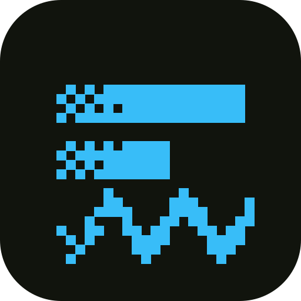

<p align="center"></p>

<p align="center"><strong>Best-in-class, open tools for games and creative work on the web.</strong></p>

<p align="center">Each tool does one job well and works on its own with whatever you already use.<br>Together they make one fast, open foundation, so you spend your time on the idea, not the plumbing.</p>

<p align="center">
<a href="https://debuff.jp"></a>
<a href="https://debuff.jp/docs/why"></a>
<a href="https://debuff.jp/examples"></a>
<a href="https://debuff.jp/docs/getting-started"></a>
<a href="https://discord.gg/jshbDHSpCY"></a>
</p>

## debuff

**[debuff](https://github.com/debuffjp/debuff)** is our framework for small, polished 2D games that run in the browser: less setup, more time for mechanics, art and weird ideas.

```bash
npm create debuff@latest my-game
```

- **A small, fast runtime.** Rendering is [spryte](https://github.com/debuffjp/spryte), which draws moving sprites 2–4× faster than the most popular 2D web renderer, at a ninth of its size, in [2dbench](https://github.com/debuffjp/2dbench).
- **Crisp pixel art out of the box.** Integer scaling, pixel snapping, and **debuff sans**, our pixel font, as the default for text.
- **Tests that play the real game.** Logic tests run the actual game in Node in milliseconds, scenarios check it in a browser (including flashes and contrast), and a fuzzer plays it with random hands until something breaks. Every finding replays exactly.
- **Dev tools that explain things.** Errors say whose bug it is and link the exact source line. Rewind and scrub a live session. Frame drops say why. Feel values become live sliders.
- **Agents as helpers, people in charge.** An MCP server and plugins for Claude Code and Codex let agents play the game you have open, read its state and errors, and run the tests. You see everything they do and can undo it.
- **Web standards only.** ES modules, a canvas, Web Audio and Gamepad. No proprietary editor or project format.

> **Status: 0.21, early development.** APIs will change, and feedback from real games shapes them.

## Tools for any web game

These work without debuff, alongside Phaser, PixiJS, three.js, KAPLAY or a plain canvas:

<table>
<tr>
<td width="50%" valign="top">&nbsp;<a href="https://github.com/debuffjp/spryte"><strong>spryte</strong></a><br>&nbsp;The renderer inside debuff, standalone. Immediate mode, batched WebGL2 with a Canvas 2D fallback, about 10 kB.</td>
<td width="50%" valign="top">&nbsp;<a href="https://github.com/debuffjp/tenten"><strong>tenten</strong></a><br>&nbsp;Headless pixel art for coding agents: sprites and animations over MCP, a CLI or a TypeScript API. Reads and writes <code>.aseprite</code>.</td>
</tr>
<tr>
<td width="50%" valign="top">&nbsp;<a href="https://github.com/debuffjp/debuff/tree/main/packages/plonk"><strong>plonk</strong></a><br>&nbsp;Game music made in code. Songs are tiny data, synthesized live with Web Audio. No audio files, a few kB.</td>
<td width="50%" valign="top">&nbsp;<a href="https://github.com/debuffjp/debuff/tree/main/packages/myaku"><strong>myaku</strong></a><br>&nbsp;A frame profiler that finds the hitches players feel and says why in plain words.</td>
</tr>
<tr>
<td width="50%" valign="top">&nbsp;<a href="https://github.com/debuffjp/debuff/tree/main/tooling/keiko"><strong>keiko</strong></a><br>&nbsp;Fast, deterministic logic tests that run your real game in Node, no browser.</td>
<td width="50%" valign="top">&nbsp;<a href="https://github.com/debuffjp/game-lint"><strong>game-lint</strong></a><br>&nbsp;Lint rules for oxlint and ESLint: unseeded randomness, real clocks and timers that break replays, allocations in update loops.</td>
</tr>
<tr>
<td width="50%" valign="top">&nbsp;<a href="https://github.com/debuffjp/2dbench"><strong>2dbench</strong></a><br>&nbsp;An open, fair benchmark for 2D web renderers, with a pixel-parity gate. <a href="https://debuffjp.github.io/2dbench/mobile.html">Run it on your device</a>.</td>
<td width="50%" valign="top">&nbsp;<a href="https://github.com/debuffjp/2d-web-game-skills"><strong>2d-web-game-skills</strong></a><br>&nbsp;Agent skills for writing and reviewing 2D web games.</td>
</tr>
</table>

## Repositories

| Repo | What's there |
| --- | --- |
| [**debuff**](https://github.com/debuffjp/debuff) | Runtime packages, CLI, scaffolder, MCP server, keiko, myaku, plonk, templates |
| [**spryte**](https://github.com/debuffjp/spryte) | The renderer: WebGL2 sprites, shapes, text, render targets and shaders, with a Canvas 2D fallback |
| [**tenten**](https://github.com/debuffjp/tenten) | Headless, scriptable pixel art and animation; `.tt` and `.aseprite` |
| [**2dbench**](https://github.com/debuffjp/2dbench) | Open benchmark for 2D web renderers, with community results from many devices |
| [**game-lint**](https://github.com/debuffjp/game-lint) | Lint rules for game logic, one plugin for oxlint and ESLint |
| [**plugins**](https://github.com/debuffjp/plugins) | Official and community plugins for debuff |
| [**2d-web-game-skills**](https://github.com/debuffjp/2d-web-game-skills) | Agent skills for 2D web games |
| [**overbuffed**](https://github.com/debuffjp/overbuffed) | A swarm survival game starring buff, built in the open to find what debuff should do better. [Play it](https://debuff.jp/play/overbuffed/) |
| [**debuff-sans**](https://github.com/debuffjp/debuff-sans) | Our pixel font as TTF, BDF and a sprite sheet, under the SIL Open Font License |
| [**brand**](https://github.com/debuffjp/brand) | The foundation mark, the debuff wordmark, buff the mascot, sprite sheet and social card |

<p align="center"></p>

## Get involved

- Come say hi, share what you're making, or ask anything on [Discord](https://discord.gg/jshbDHSpCY).
- Everything we make is free: code under MIT, the font under the SIL Open Font License. [Sponsor us on GitHub](https://github.com/sponsors/debuffjp) to keep it that way.
- Bugs and ideas: [open an issue](https://github.com/debuffjp/debuff/issues).
- Read the [contributing guide](https://github.com/debuffjp/debuff/blob/main/CONTRIBUTING.md) and the [roadmap](https://github.com/debuffjp/debuff/blob/main/docs/roadmap.md), or build a [plugin](https://github.com/debuffjp/debuff/blob/main/docs/plugins.md).
- Everyone is welcome under our [code of conduct](https://github.com/debuffjp/debuff/blob/main/CODE_OF_CONDUCT.md).
